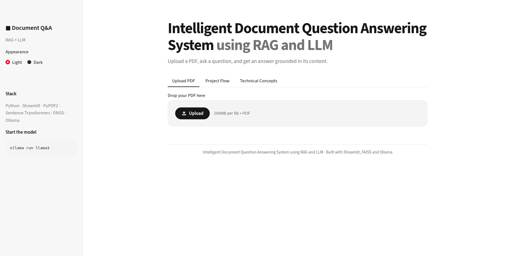
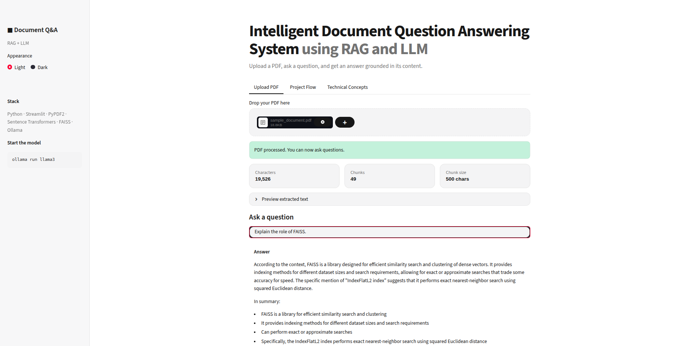
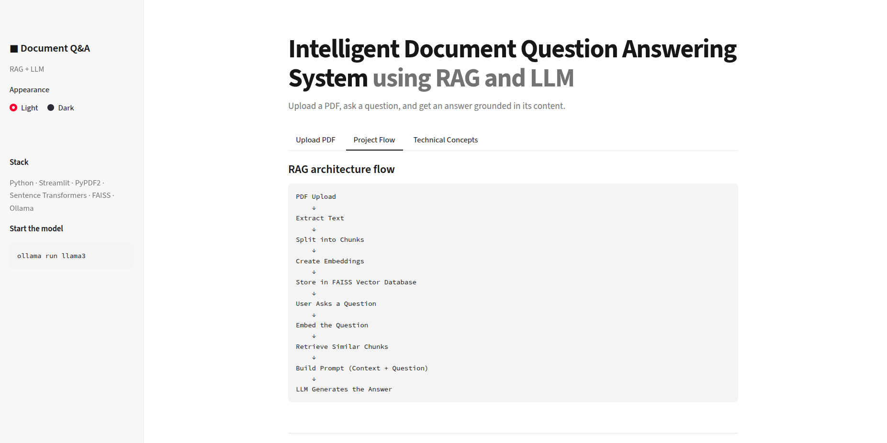
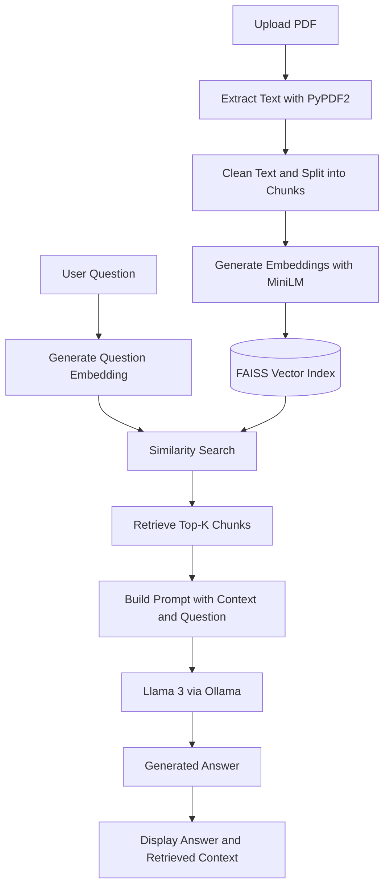

<div align="center">

# Intelligent Document Question Answering System using RAG and LLM

**An AI-powered document assistant that transforms PDFs into searchable knowledge using Retrieval-Augmented Generation (RAG), semantic search, and local LLM inference.**

Upload a PDF, ask questions in natural language, and receive context-aware answers grounded in the document.

🔒 **Privacy-focused:** Runs locally using Ollama and Llama 3 without requiring external LLM APIs.


-171717>)


---



</div>

---

## Table of Contents

1. [Overview](#1-overview)
2. [Key Highlights](#2-key-highlights)
3. [Features](#3-features)
4. [Screenshots](#4-screenshots)
5. [System Architecture](#5-system-architecture)
6. [Tech Stack](#6-tech-stack)
7. [Project Structure](#7-project-structure)
8. [How It Works](#8-how-it-works-step-by-step)
9. [Numerical Calculations](#9-numerical-calculations)
10. [Installation and Setup](#10-installation-and-setup)
11. [Usage](#11-usage)
12. [Configuration](#12-configuration)
13. [Troubleshooting](#13-troubleshooting)
14. [Limitations and Future Improvements](#14-limitations-and-future-improvements)
15. [License](#15-license)
16. [Author](#16-author)

---

## 1. Overview

Large Language Models (LLMs) are powerful at generating human-like responses, but they do not automatically have access to the information contained in private documents. They may also generate incorrect or unsupported information, commonly known as hallucinations.

This project addresses this limitation using **Retrieval-Augmented Generation (RAG)**.

The application allows users to upload a PDF document and ask questions about its contents. Instead of relying entirely on the LLM's internal knowledge, the system retrieves relevant information from the uploaded document and uses it as context to generate an answer.

### How the System Works

1. The uploaded PDF is processed and its text is extracted.
2. The extracted text is divided into smaller, overlapping chunks.
3. Each chunk is converted into a numerical vector called an embedding.
4. The embeddings are stored in a FAISS vector index.
5. When a user asks a question, the question is converted into an embedding.
6. FAISS retrieves the most relevant document chunks using similarity search.
7. The retrieved context and question are passed to a local Llama 3 model.
8. The LLM generates a response based on the retrieved context.

The system is designed to answer questions using the uploaded document. If relevant information cannot be found, it is instructed to respond:

> I could not find the answer in the uploaded PDF.

The entire question-answering pipeline runs locally after the initial setup and model downloads, without requiring a cloud-based LLM API.

---

## 2. Key Highlights

- **Retrieval-Augmented Generation (RAG):** Combines information retrieval with LLM-based answer generation.
- **Semantic Search:** Retrieves relevant content based on contextual meaning rather than exact keyword matching.
- **Local LLM Inference:** Uses Llama 3 through Ollama to generate answers locally.
- **Privacy-Focused Processing:** Uploaded documents are processed locally without sending them to cloud-based LLM services.
- **Vector Search:** Uses FAISS for similarity-based document retrieval.
- **Context-Grounded Responses:** Answers are generated using retrieved document content.
- **Interactive Interface:** Provides a user-friendly interface built with Streamlit.
- **Efficient Processing:** Processes and indexes the uploaded PDF once, allowing faster follow-up queries.

---

## 3. Features

- Upload text-based PDF documents.
- Ask questions using natural language.
- Semantic similarity search for retrieving relevant information.
- Context-grounded answers using a local LLM.
- Local inference using Ollama and Llama 3.
- No OpenAI API key or cloud LLM API required.
- Displays retrieved context for answer verification.
- Document statistics including character count and chunk count.
- Light and Dark themes with a monochrome design.
- PDF indexing and processing cached for subsequent questions.
- Handles invalid characters in extracted PDF text to prevent embedding errors.

---

## 4. Screenshots

### Home Screen

<p align="center">
  
</p>

---

### Question & Answer

<p align="center">
  
</p>

---

### Project Flow

<p align="center">
  
</p>

---

## 5. System Architecture

The application follows a Retrieval-Augmented Generation pipeline consisting of document processing, embedding generation, vector storage, retrieval, and response generation.



### Processing Phases

| Phase                  | When It Runs                         | Operations                                                                                           |
| ---------------------- | ------------------------------------ | ---------------------------------------------------------------------------------------------------- |
| **Document Indexing**  | When a PDF is uploaded or changed    | Text extraction, cleaning, chunking, embedding generation, and vector indexing                       |
| **Question Answering** | Whenever the user submits a question | Question embedding, similarity search, context retrieval, prompt construction, and answer generation |

---

## 6. Tech Stack

| Component            | Technology            | Purpose                                        |
| -------------------- | --------------------- | ---------------------------------------------- |
| Programming Language | Python                | Core application logic                         |
| Frontend / UI        | Streamlit             | User interface, file upload, tabs, and themes  |
| PDF Processing       | PyPDF2                | Extract text from PDF documents                |
| Embedding Model      | Sentence Transformers | Convert text into numerical embeddings         |
| Embedding Model Name | `all-MiniLM-L6-v2`    | Generate semantic representations              |
| Vector Database      | FAISS                 | Similarity search and vector storage           |
| LLM                  | Llama 3               | Generate answers using retrieved context       |
| Local LLM Runtime    | Ollama                | Run Llama 3 locally                            |
| Numerical Processing | NumPy                 | Embedding array operations and data conversion |
| HTTP Requests        | Requests              | Communicate with Ollama's REST API             |

---

## 7. Project Structure

```text
Intelligent_Document_Question_Answering_System_using_RAG_and_LLM/
│
├── app.py
├── requirements.txt
├── README.md
├── LICENSE
├── .gitignore
│
├── .streamlit/
│   └── config.toml
│
├── sample_documents/
│
└── assets/
    ├── home.png
    ├── question-answer.png
    └── project-flow.png
```

### Functions in `app.py`

| Function                                | Description                                                    |
| --------------------------------------- | -------------------------------------------------------------- |
| `build_css(theme_name)`                 | Generates CSS styles for Light and Dark themes                 |
| `extract_text_from_pdf(pdf_file)`       | Extracts text from PDF pages and cleans invalid characters     |
| `split_text_into_chunks(text)`          | Splits document text into overlapping chunks                   |
| `load_embedding_model()`                | Loads and caches the Sentence Transformer embedding model      |
| `create_vector_database(chunks, model)` | Generates chunk embeddings and stores them in a FAISS index    |
| `search_relevant_chunks(question, ...)` | Retrieves the most relevant chunks for a given question        |
| `ask_llm(question, context)`            | Sends the question and retrieved context to Llama 3 via Ollama |
| `show_project_flow()`                   | Displays the project's processing pipeline                     |
| `process_pdf(file, model)`              | Processes and indexes the uploaded PDF and caches the result   |

---

## 8. How It Works (Step by Step)

### Step 1: PDF Text Extraction

The uploaded PDF is processed using PyPDF2.

Text is extracted page by page and combined into a single text string. Invalid Unicode characters and null characters are cleaned to prevent errors during embedding generation.

---

### Step 2: Text Chunking

The extracted text is divided into smaller chunks to make retrieval more effective.

The application uses:

- **Chunk Size:** 500 characters
- **Chunk Overlap:** 100 characters
- **Chunk Step:** 400 characters

The overlap helps preserve context between neighboring chunks, reducing the chance that important information is lost when text is divided.

```text
Chunk 1: characters     0 -  500
Chunk 2: characters   400 -  900
Chunk 3: characters   800 - 1300

              <---- 100 characters overlap ---->
```

Each new chunk begins 400 characters after the previous chunk, while 100 characters are shared between consecutive chunks.

---

### Step 3: Embedding Generation

The project uses the Sentence Transformer model:

```text
all-MiniLM-L6-v2
```

The model converts each text chunk into a numerical vector containing **384 dimensions**.

These vectors represent the semantic meaning of the text, allowing the system to retrieve information based on similarity in meaning rather than relying only on exact word matches.

For example, a question asking:

> How does AI learn from data?

may retrieve content discussing Machine Learning, even if the exact wording is different.

---

### Step 4: Vector Storage

The generated embeddings are stored in a FAISS index using:

```python
faiss.IndexFlatL2
```

This index performs exact nearest-neighbor searches using squared Euclidean distance.

Each document chunk has a corresponding embedding stored in the index, allowing the application to search through the document efficiently.

---

### Step 5: Semantic Retrieval

When the user asks a question:

1. The question is converted into an embedding using the same Sentence Transformer model.
2. FAISS compares the question vector with stored document vectors.
3. The closest vectors are identified using L2 distance.
4. The corresponding text chunks are retrieved.

The application retrieves the **Top 3 most relevant chunks**.

```python
TOP_K = 3
```

These chunks provide the context used for answer generation.

---

### Step 6: Context Construction

The retrieved chunks are combined into a context block.

The system constructs a prompt containing:

- Retrieved document context
- User's question
- Instructions to answer only from the supplied context

This helps limit unsupported answers and encourages the LLM to remain grounded in the uploaded document.

---

### Step 7: Answer Generation

The constructed prompt is sent to the local Llama 3 model through Ollama.

Ollama exposes a local REST API:

```text
http://localhost:11434/api/generate
```

Llama 3 processes the retrieved context and question to generate the final response.

The answer is displayed in the Streamlit interface, along with the retrieved context for transparency and verification.

---

## 9. Numerical Calculations

The following calculations are based on an actual run of the application using a sample PDF containing **19,526 characters**, which generated **49 chunks**.

### 9.1 Number of Chunks

Given:

- Chunk Size (S) = 500
- Overlap (O) = 100
- Step Size = Chunk Size − Overlap

```text
Step Size = 500 - 100
          = 400 characters
```

The number of chunks can be estimated using:

```text
Number of Chunks = ceil((N - O) / (S - O))
```

Where:

- N = Total characters
- S = Chunk size
- O = Chunk overlap

For the sample PDF:

```text
N = 19,526

Number of Chunks = ceil((19,526 - 100) / 400)

                 = ceil(19,426 / 400)

                 = ceil(48.565)

                 = 49 chunks
```

This matches the number of chunks displayed by the application.

---

### 9.2 Size of the Last Chunk

The 49th chunk has index 48, starting from index 0.

```text
Last Chunk Start = 400 × 48

                 = 19,200
```

Remaining characters:

```text
19,526 - 19,200 = 326 characters
```

Therefore, the last chunk contains 326 characters.

---

### 9.3 Overlap Overhead

Total text stored across all chunks:

```text
48 full chunks × 500 characters
+ 1 last chunk × 326 characters

= 24,000 + 326

= 24,326 characters
```

Overlap overhead ratio:

```text
24,326 / 19,526 ≈ 1.246
```

The chunking process stores approximately **24.6% additional text** compared with the original text due to overlapping chunks.

This overlap helps preserve context around chunk boundaries.

---

### 9.4 Embedding Storage

The `all-MiniLM-L6-v2` model produces:

- 384 dimensions per vector
- 4 bytes per `float32` value

Storage per embedding:

```text
384 × 4 = 1,536 bytes
```

For 49 chunks:

```text
49 × 1,536 = 75,264 bytes
```

Approximately:

```text
75,264 bytes ≈ 73.5 KiB
```

This represents the raw vector storage and excludes additional FAISS and application overhead.

---

### 9.5 Similarity Search Using L2 Distance

FAISS `IndexFlatL2` calculates squared Euclidean distance between the question embedding and document embeddings.

The formula is:

```text
D(q, c) = Σ(qᵢ - cᵢ)²
```

Where:

- q = Question embedding
- c = Document chunk embedding
- d = Embedding dimension (384)

#### Example in 2 Dimensions

```text
q  = (1, 2)

c1 = (2, 3)
c2 = (4, 6)
```

Distance from q to c1:

```text
D(q, c1) = (1 - 2)² + (2 - 3)²

         = 1 + 1

         = 2
```

Distance from q to c2:

```text
D(q, c2) = (1 - 4)² + (2 - 6)²

         = 9 + 16

         = 25
```

Since c1 has the smaller distance, it is considered more similar to q and is ranked ahead of c2.

**Smaller L2 distance indicates greater similarity** in this retrieval setup.

---

### 9.6 Search Complexity

FAISS `IndexFlatL2` performs an exact search by comparing the query embedding against every stored embedding.

For 49 vectors with 384 dimensions:

```text
49 × 384 = 18,816 dimension-wise comparisons
```

The computational complexity of a flat vector search is approximately:

```text
O(N × D)
```

Where:

- N = Number of stored vectors
- D = Embedding dimensions

The search cost grows linearly with the number of chunks. For small documents, this approach is practical and straightforward.

For very large collections, approximate nearest-neighbor indexes such as `IndexIVFFlat` or `IndexHNSWFlat` can be considered to reduce retrieval time.

---

### 9.7 Context Size Sent to the LLM

The application retrieves 3 chunks, each containing up to 500 characters.

```text
Maximum Context Characters = TOP_K × Chunk Size

                           = 3 × 500

                           = 1,500 characters
```

Using the rough estimate of 4 characters per token:

```text
Estimated Tokens = 1,500 / 4

                 ≈ 375 tokens
```

This is an approximate estimate; actual token counts vary based on the text.

---

### 9.8 How the System Scales

Assuming approximately 3,000 characters per page:

| Document Size | Approx. Characters | Approx. Chunks | Raw Vector Storage | Dimension-wise Comparisons / Query |
| ------------- | -----------------: | -------------: | -----------------: | ---------------------------------: |
| 10 pages      |             30,000 |             75 |          112.5 KiB |                             28,800 |
| 100 pages     |            300,000 |            750 |           1.10 MiB |                            288,000 |
| 1,000 pages   |          3,000,000 |          7,500 |          10.99 MiB |                          2,880,000 |

The calculations assume 500-character chunks, 100-character overlap, 384-dimensional embeddings, and 4 bytes per vector dimension.

As the document collection grows, the number of vectors increases, resulting in higher search costs for exact flat indexes.

---

## 10. Installation and Setup

### Prerequisites

- Python 3.10 or newer
- Ollama installed
- Approximately 6 GB of free disk space for the LLM and embedding model
- At least 8 GB RAM recommended
- Internet connection for initial dependency and model downloads

### Step 1: Clone the Repository

```bash
git clone https://github.com/SanketHajare44/Intelligent_Document_Question_Answering_System_using_RAG_and_LLM.git
```

Navigate to the project directory:

```bash
cd Intelligent_Document_Question_Answering_System_using_RAG_and_LLM
```

### Step 2: Create a Virtual Environment

```bash
python3 -m venv .venv
```

Activate the virtual environment on Linux/macOS:

```bash
source .venv/bin/activate
```

On Windows:

```bash
.venv\Scripts\activate
```

### Step 3: Install Dependencies

```bash
pip install -r requirements.txt
```

### Step 4: Install Ollama

Download and install Ollama from its official website:

https://ollama.com

For Linux, you can also use:

```bash
curl -fsSL https://ollama.com/install.sh | sh
```

### Step 5: Download and Run Llama 3

```bash
ollama run llama3
```

This downloads the model if it isn't already available and starts it.

Ollama runs its local API at:

```text
http://localhost:11434
```

Keep Ollama running while using the application.

### Step 6: Start the Streamlit Application

Open another terminal, navigate to the project directory, and activate the virtual environment if necessary.

Run:

```bash
streamlit run app.py
```

Open your browser at:

```text
http://localhost:8501
```

On the first run, the Sentence Transformer embedding model will be downloaded and cached. Subsequent runs can reuse the cached model.

---

## 11. Usage

1. Start Ollama and ensure Llama 3 is available.
2. Launch the Streamlit application.
3. Navigate to the **Upload PDF** tab.
4. Upload a text-based PDF document.
5. Wait for the PDF to be processed and indexed.
6. Review the document statistics displayed by the application.
7. Enter a question related to the uploaded PDF.
8. Submit the question.
9. Read the generated response.
10. Expand **View Retrieved Context** to inspect the chunks used to generate the answer.
11. Use the Appearance setting in the sidebar to switch between Light and Dark themes.

### Example Questions

```text
What is Artificial Intelligence?

Explain the role of FAISS in this project.

How are text embeddings generated?

Why is overlapping chunking used?

Explain the complete RAG pipeline.

What is the difference between semantic search and keyword search?
```

To test whether the application avoids unsupported answers, ask a question about information that is not present in the uploaded PDF.

The application should indicate that the answer could not be found in the document.

---

## 12. Configuration

The application uses configurable constants defined in `app.py`.

| Constant               | Default Value                         | Description                                    |
| ---------------------- | ------------------------------------- | ---------------------------------------------- |
| `EMBEDDING_MODEL_NAME` | `all-MiniLM-L6-v2`                    | Sentence Transformer model used for embeddings |
| `OLLAMA_URL`           | `http://localhost:11434/api/generate` | Ollama generation API endpoint                 |
| `OLLAMA_MODEL`         | `llama3`                              | Local LLM used for answer generation           |
| `CHUNK_SIZE`           | `500`                                 | Maximum characters per chunk                   |
| `CHUNK_OVERLAP`        | `100`                                 | Characters overlapping between chunks          |
| `TOP_K`                | `3`                                   | Number of chunks retrieved per question        |

### Tuning

- **Missing relevant information:** Increase `TOP_K` to retrieve more chunks.
- **Irrelevant context:** Reduce `TOP_K` or experiment with chunk size.
- **Slow answer generation:** Consider a smaller LLM model.
- **Large documents:** Experiment with chunking strategies and FAISS index types.
- **Retrieval quality:** Consider adding reranking or improving embedding models.

---

## 13. Troubleshooting

| Problem                  | Possible Cause                              | Solution                                                      |
| ------------------------ | ------------------------------------------- | ------------------------------------------------------------- |
| Ollama connection error  | Ollama server isn't running                 | Start Ollama and ensure it is available locally               |
| Model not found          | Llama 3 hasn't been downloaded              | Run `ollama pull llama3`                                      |
| `TextEncodeInput` error  | Invalid characters in extracted PDF text    | Clean the extracted text before embedding                     |
| No readable text found   | PDF is scanned or image-based               | Use OCR to extract text before uploading                      |
| First run is slow        | Embedding model is downloading              | Wait for the initial download to complete                     |
| Slow responses           | LLM inference is resource-intensive         | Use a smaller model or hardware with better compute resources |
| FAISS installation error | Package or environment issue                | Install `faiss-cpu` in the virtual environment                |
| Port 8501 already in use | Another Streamlit instance is running       | Stop the existing instance or use another port                |
| Poorly relevant answers  | Retrieval isn't selecting the right context | Experiment with chunk size, overlap, or Top-K                 |

---

## 14. Limitations and Future Improvements

### Current Limitations

- Supports only one PDF at a time.
- Scanned/image-only PDFs are not supported without OCR.
- No conversational memory between questions.
- Chunking is based on character count rather than semantic boundaries.
- Retrieval uses a basic exact-search FAISS index.
- Answer quality depends on the quality of the extracted text and retrieved context.
- No source page number citations are currently provided.

### Future Improvements

- Implement sentence-aware or recursive text chunking.
- Support multiple PDFs simultaneously.
- Add conversational memory for follow-up questions.
- Support DOCX and TXT documents.
- Display source page numbers with retrieved chunks.
- Implement streaming LLM responses.
- Add reranking for improved retrieval accuracy.
- Integrate OCR for scanned documents.
- Experiment with advanced retrieval strategies.
- Add evaluation metrics to measure retrieval and answer quality.
- Improve document management and indexing for larger collections.

---

## 15. License

This project is licensed under the **MIT License**.

See the [LICENSE](LICENSE) file for more information.

---

## 16. Author

**Sanket Hajare**

Computer Engineering Graduate | AI/ML | Python | Generative AI

GitHub: [@SanketHajare44](https://github.com/SanketHajare44)

---

⭐ If you found this project useful or interesting, consider giving the repository a star!
